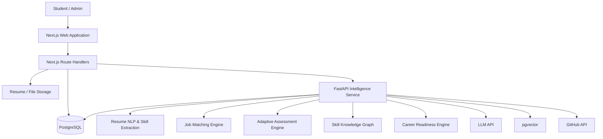
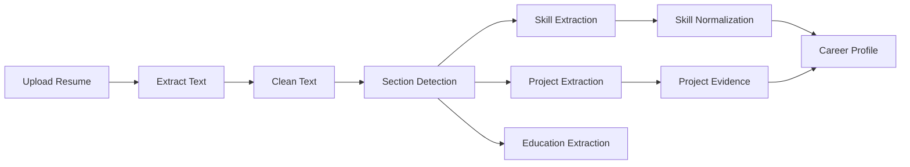
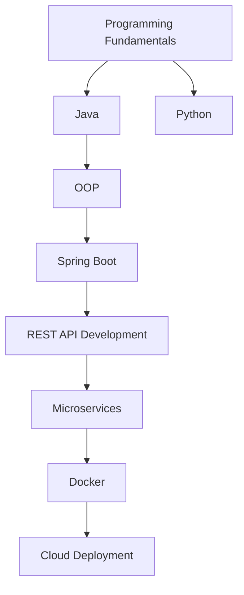
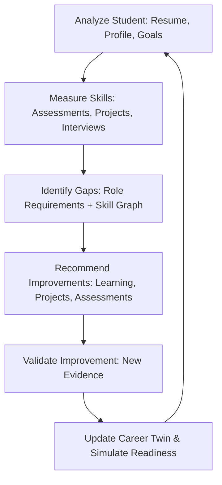

# CareerTwin AI

## Evidence-Aware Career Intelligence & Employability Simulation Platform

CareerTwin AI is an AI- and ML-powered career intelligence platform that continuously estimates a student's employability for a target role. It analyzes resumes, validates skills through assessments and project evidence, identifies prerequisite-aware skill gaps, recommends personalized improvement paths, and simulates how targeted improvements may affect career readiness.

> **Core idea:** A student should not be considered skilled only because a resume claims it. CareerTwin AI combines claimed, demonstrated, applied, and verified evidence to build an evolving profile of the student's capabilities.

---

## 1. Project Identity

- **Project name:** CareerTwin AI
- **Proposed title:** *CareerTwin AI: An Evidence-Aware Career Intelligence and Employability Simulation Platform*
- **Project type:** B.Tech Computer Science Engineering Major Project
- **Domains:** Artificial Intelligence, Machine Learning, NLP, Recommender Systems, Knowledge Graphs, Explainable Analytics, Full-Stack Development
- **Target users:** B.Tech/B.E. students, final-year placement candidates, internship seekers, career mentors, and college placement cells

---

## 2. Problem Statement

Students often rely on resumes, online courses, generic job recommendations, and self-reported skills to assess their employability. These approaches do not reliably establish whether a student possesses the theoretical and practical skills required for a specific role.

Existing career platforms may provide job matching and skill-gap recommendations without adequately considering verified proficiency, prerequisite dependencies, practical project evidence, or a student's changing capabilities. Students may therefore pursue irrelevant learning paths, focus on low-priority skills, or apply for roles without understanding their actual deficiencies.

CareerTwin AI aims to develop an evidence-aware, adaptive career intelligence platform that estimates student proficiency using multiple evidence sources, identifies prerequisite-based skill gaps, recommends personalized improvement paths, and simulates how targeted skill improvements may affect career readiness.

---

## 3. Objectives

### Primary objectives

1. Analyze resumes and extract skills, education, projects, and experience.
2. Build a dynamic student skill profile using multiple evidence sources.
3. Estimate skill proficiency and confidence rather than relying only on self-reported skills.
4. Develop adaptive assessments that test actual knowledge.
5. Construct a skill dependency knowledge graph for prerequisite relationships.
6. Identify skill gaps for selected career roles.
7. Recommend personalized learning paths and practical projects.
8. Develop explainable job matching and career-readiness scoring.
9. Build a career simulator for hypothetical skill improvements.
10. Evaluate the system using ML metrics and user testing.

### Secondary objectives / extensions

- AI mock technical and HR interviews
- GitHub repository-based skill evidence
- Job-market trend analysis
- Job application tracking
- Job-posting risk analysis
- Placement-cell analytics

---

## 4. Proposed Research Gap

Conventional career platforms often focus on resume analysis, keyword-based job matching, skill-gap lists, and generic learning recommendations.

CareerTwin AI proposes to investigate an integrated framework combining:

- Multi-source skill evidence
- Adaptive proficiency estimation
- Prerequisite-aware skill planning
- Explainable career-readiness computation
- Project-based skill validation
- Feedback-driven employability improvement
- Career what-if simulation

### Proposed research contribution

Investigate whether combining resume-derived skill claims with assessment and project evidence can produce more meaningful career-readiness estimates and more useful skill recommendations than a conventional resume-keyword-based approach.

This is a research hypothesis to evaluate—not a claim that no prior system has explored these ideas.

---

## 5. Recommended Technology Stack

### Overall stack

| Layer | Technology | Purpose |
|---|---|---|
| Frontend | Next.js App Router | Full-stack React application, routing, UI |
| Language | TypeScript | Type safety |
| Styling | Tailwind CSS | Responsive styling |
| UI components | shadcn/ui | Reusable UI components |
| Charts | Recharts | Skill and career analytics |
| Graph visualization | React Flow | Interactive skill dependency graph |
| Web backend | Next.js Route Handlers | CRUD, auth-related endpoints, orchestration |
| Intelligence backend | Python + FastAPI | AI/ML and career intelligence services |
| Main database | PostgreSQL | Structured, relational application data |
| TypeScript ORM | Prisma | Type-safe database access |
| Python ORM | SQLAlchemy | Python service database access, as needed |
| Vector search | pgvector | Semantic search and embeddings |
| Authentication | Auth.js | Authentication and sessions |
| File storage | Supabase Storage or S3-compatible storage | Resumes and user files |
| NLP | spaCy + skill taxonomy + LLM structured extraction | Skill extraction and normalization |
| ML | Scikit-learn | Classification, prediction, and experiments |
| Embeddings | Sentence Transformers or embedding API | Semantic resume/job matching |
| Knowledge graph | NetworkX | Prerequisite graph and pathfinding |
| GitHub integration | GitHub API | Repository evidence |
| Testing | Vitest, Playwright, pytest | Unit, integration, UI, and ML tests |
| Deployment | Docker | Containerization |
| CI/CD | GitHub Actions | Automated testing and deployment |

### Why Next.js?

Next.js is recommended over a separate React + Vite frontend for this project because CareerTwin AI needs dashboards, authentication, protected pages, routing, API endpoints, server-side functionality, and interactive components. Next.js can provide the web application and backend-for-frontend while the separate FastAPI service handles Python-specific AI/ML logic.

### Why PostgreSQL instead of MongoDB?

The project has many related entities—students, skills, evidence, assessments, jobs, job skills, roles, roadmaps, applications, and simulations. PostgreSQL provides relational integrity and structured querying, while pgvector can add vector similarity search within the same database. MongoDB is also possible, but PostgreSQL is the recommended primary database for this data model.

---

## 6. System Architecture

CareerTwin AI uses a modular architecture rather than unnecessary microservices.



### Component responsibilities

#### Next.js web application

- User interface
- Authentication and authorization
- Dashboard and analytics
- Resume upload
- Job browsing
- Skill profile
- Assessment interface
- Roadmap interface
- Career simulator
- Admin panel
- CRUD APIs
- Calls to the Python intelligence service

#### FastAPI intelligence service

- Resume parsing
- Skill extraction and normalization
- Embedding generation
- Semantic job matching
- Skill proficiency estimation
- Adaptive question selection
- Recommendation ranking
- Skill graph processing
- Career-readiness calculations
- AI interview feedback
- ML model inference

#### PostgreSQL

Stores users, student profiles, skills, evidence, assessments, jobs, recommendations, applications, simulations, and interview records.

#### LLM API

Use selectively for resume interpretation, question generation, explanations, interview simulation, feedback, project challenge generation, and roadmap explanations. Scores, ranking, and calculations should be deterministic and testable wherever possible.

---

## 7. Functional Modules

### Module 1 — Authentication & Student Profile

**Features**
- Registration and login
- Student profile and education
- Target job roles
- Preferred locations and industries
- Career goals and experience level
- Resume upload

**Profile data**
- Name and email
- Degree and branch
- Graduation year
- Target roles
- Preferred industries
- Career goals

### Module 2 — Resume Intelligence Engine

**Pipeline**



Extract:
- Skills
- Programming languages
- Frameworks
- Databases
- Projects
- Education
- Certifications
- Experience
- Achievements

Suggested tools: PyMuPDF for PDFs, python-docx for DOCX, spaCy for NLP, skill dictionaries/taxonomies, structured LLM extraction, and validation/normalization.

Example normalization:
- `ReactJS` → `React`
- `Mongo` → `MongoDB`
- `RESTful web services` → `REST API Development`

Use a hybrid approach (dictionaries, NLP, structured LLM extraction) rather than relying solely on an LLM.

### Module 3 — Career Digital Twin (Flagship)

A continuously updated intelligence profile of a student's skills, proficiency, confidence, evidence, and development.

Each skill profile can include:

| Field | Example |
|---|---|
| Skill | Java |
| Proficiency | 72/100 |
| Confidence | 85/100 |
| Level | Intermediate |
| Evidence count | 4 |
| Last assessment | Date |
| Evidence sources | Quiz, project, resume |
| Target proficiency | 90 |
| Trend | Improving |

Evidence sources:
1. Resume
2. MCQ assessment
3. Coding test
4. Project
5. GitHub repository
6. Mock interview
7. Self-assessment

The profile updates as new evidence is collected.

A basic evidence-weighted model can be prototyped:

\[
S_{new} = \frac{\sum_{i=1}^{n}w_i s_i}{\sum_{i=1}^{n}w_i}
\]

Where `s_i` is an evidence score and `w_i` is the evidence reliability weight. Prototype weights must be calibrated and tested. Account for recency, difficulty, verification, and overlapping evidence; avoid counting the same evidence twice.

### Module 4 — Skill Assessment Engine

**Assessment types**
- MCQs
- Output prediction
- Debugging
- Coding questions
- SQL challenges
- Conceptual questions
- Scenario-based questions

**Adaptive flow**
- Start at medium difficulty.
- Correct answer → increase difficulty.
- Incorrect answer → lower difficulty or assess a prerequisite.
- Track topic-level performance.
- Stop when sufficient evidence is collected or the question limit is reached.

Initially use adaptive rules. Later, explore Item Response Theory (IRT) or Bayesian Knowledge Tracing if sufficient data is available.

### Module 5 — Skill Dependency Knowledge Graph

Represent skills and prerequisite relationships as a directed graph.

Example:



**Node properties**
- Skill ID and name
- Category
- Difficulty
- Importance
- Student proficiency
- Target proficiency

**Edge properties**
- Prerequisite skill
- Dependent skill
- Dependency strength
- Relationship type

**Algorithms**
- Topological sorting
- Breadth-first search
- Shortest path
- Dependency traversal
- Optional centrality measures

Example recommendation: If Spring Boot is a target but OOP proficiency is weak, recommend strengthening OOP first, then Spring Boot, REST APIs, authentication, and Docker.

### Module 6 — Job Intelligence & Matching Engine

Job data can include:
- Title
- Company
- Description
- Required and preferred skills
- Experience
- Location
- Salary (if reliable)
- Job type
- Source

Matching steps:
1. Required-skill coverage
2. Semantic similarity
3. Proficiency compatibility
4. Experience compatibility
5. Preference compatibility

An initial hybrid matching formula can be prototyped:

\[
M = 0.40K + 0.30E + 0.20P + 0.10R
\]

Where:
- `K` = skill coverage
- `E` = semantic similarity
- `P` = proficiency match
- `R` = experience and preference compatibility

These weights are hypotheses to tune and validate—not universal values.

Example result:

> **Backend Developer — 78% match**
>
> Strong matches: Java, SQL, OOP  
> Gaps: Spring Boot, Docker  
> Explanation: Good programming and database fundamentals; backend framework experience is the largest gap.

Explain each match and gap.

### Module 7 — Skill Gap & Personalized Roadmap Engine

Identify skill gaps and prioritize them.

Example priority model:

\[
P_i = D_i \times I_i \times G_i \times Q_i
\]

Where:
- `D_i` = market demand
- `I_i` = target-role importance
- `G_i` = proficiency gap
- `Q_i` = confidence that the gap is real

Normalize factors before calculation. Then:
1. Rank skills.
2. Check prerequisite dependencies.
3. Build learning sequence.
4. Estimate effort.
5. Recommend resources.
6. Assign practical challenges.
7. Track progress.
8. Recalculate priorities.

### Module 8 — Project-Based Skill Validation

Turn skill gaps into practical challenges.

Example challenge: **Campus Event Management API**

Requirements:
- Create, retrieve, update, and delete events
- User authentication
- Input validation
- Pagination
- Database integration
- API documentation
- Tests

Example rubric:

| Criterion | Weight |
|---|---:|
| Functional requirements | 30% |
| API design | 20% |
| Database implementation | 15% |
| Code quality | 15% |
| Security | 10% |
| Testing | 10% |

Potential integrations:
- GitHub repository link
- README analysis
- Repository structure checks
- API endpoint checks
- Test execution
- Static code analysis
- AI code review
- Rubric-based scoring

Do not let an LLM claim that code works without running tests or appropriate verification. Use automated tools for verification and AI for interpretation and feedback.

### Module 9 — AI Mock Interview (Advanced)

Interview modes:
- Resume interview
- Technical interview
- HR interview
- Project interview
- Job-specific interview

Flow:
1. Select target role.
2. Select interview type.
3. Generate question.
4. Student answers.
5. Evaluate answer.
6. Generate follow-up.
7. Update interview analytics.
8. Update Career Twin.

Feedback dimensions:
- Technical correctness
- Conceptual depth
- Answer structure
- Relevant examples
- Missing concepts
- Suggested improved answer

### Module 10 — Career Readiness Simulator (Flagship Demo)

Example target: Backend Developer

| Category | Illustrative score |
|---|---:|
| Programming | 72 |
| DSA | 48 |
| DBMS | 78 |
| OS | 55 |
| Networking | 42 |
| Backend framework | 30 |
| Projects | 65 |
| Interview | 50 |

The student simulates:
- DSA: 48 → 75
- Spring Boot: 30 → 80
- Complete a backend project
- Interview: 50 → 75

The system recalculates skill coverage, role compatibility, readiness, job matches, remaining gaps, and next steps.

Scores must be based on a defined algorithm and clearly labeled as estimates—not guarantees of hiring outcomes.

---

## 8. Database Design

### Entity overview

```text
users
  └── student_profiles
        ├── resumes
        ├── skill_profiles
        │     └── skill_evidence
        ├── assessments
        │     └── assessment_attempts
        ├── projects
        │     └── project_evaluations
        ├── career_goals
        ├── roadmaps
        │     └── roadmap_items
        ├── job_applications
        ├── interviews
        │     └── interview_answers
        └── career_simulations

skills
  ├── skill_profiles
  ├── job_skills
  ├── assessment_questions
  └── skill_dependencies

jobs
  └── job_skills

career_roles
  └── role_skills
```

### Core tables

| Table | Purpose |
|---|---|
| `users` | Login and identity |
| `student_profiles` | Education and career profile |
| `resumes` | Uploaded resumes and extracted content |
| `skills` | Central skill catalog |
| `skill_profiles` | Student proficiency and confidence |
| `skill_evidence` | Evidence from multiple sources |
| `skill_dependencies` | Prerequisite relationships |
| `career_roles` | Target roles |
| `role_skills` | Required skill levels for roles |
| `jobs` | Job listings and descriptions |
| `job_skills` | Skills extracted from jobs |
| `assessments` | Assessment definitions |
| `assessment_questions` | Question bank |
| `assessment_attempts` | Student attempts |
| `assessment_responses` | Answers and evaluation |
| `projects` | Student projects and challenges |
| `project_evaluations` | Project evidence and scores |
| `roadmaps` | Personalized roadmaps |
| `roadmap_items` | Action items |
| `interviews` | Mock interview sessions |
| `interview_answers` | Answers and feedback |
| `job_applications` | Application tracking |
| `career_simulations` | What-if results |

### Example SQL schemas

```sql
CREATE TABLE skills (
    id UUID PRIMARY KEY,
    name VARCHAR(150) UNIQUE NOT NULL,
    category VARCHAR(100),
    description TEXT,
    difficulty_level INTEGER
);
```

```sql
CREATE TABLE skill_profiles (
    id UUID PRIMARY KEY,
    student_id UUID NOT NULL,
    skill_id UUID NOT NULL REFERENCES skills(id),
    proficiency_score DECIMAL(5,2),
    confidence_score DECIMAL(5,2),
    proficiency_level VARCHAR(30),
    last_assessed_at TIMESTAMP,
    UNIQUE(student_id, skill_id)
);
```

```sql
CREATE TABLE skill_evidence (
    id UUID PRIMARY KEY,
    student_id UUID NOT NULL,
    skill_id UUID NOT NULL REFERENCES skills(id),
    evidence_type VARCHAR(50),
    score DECIMAL(5,2),
    confidence DECIMAL(5,2),
    source_id UUID,
    verified BOOLEAN DEFAULT FALSE,
    created_at TIMESTAMP DEFAULT CURRENT_TIMESTAMP
);
```

```sql
CREATE TABLE skill_dependencies (
    prerequisite_skill_id UUID REFERENCES skills(id),
    dependent_skill_id UUID REFERENCES skills(id),
    dependency_strength DECIMAL(4,3),
    PRIMARY KEY (prerequisite_skill_id, dependent_skill_id)
);
```

```sql
CREATE TABLE role_skills (
    role_id UUID,
    skill_id UUID REFERENCES skills(id),
    required_level DECIMAL(5,2),
    importance DECIMAL(5,2),
    PRIMARY KEY (role_id, skill_id)
);
```

```sql
CREATE TABLE jobs (
    id UUID PRIMARY KEY,
    title VARCHAR(200),
    company VARCHAR(200),
    description TEXT,
    experience_required VARCHAR(100),
    location VARCHAR(200),
    source_url TEXT,
    posted_at TIMESTAMP,
    created_at TIMESTAMP DEFAULT CURRENT_TIMESTAMP
);
```

The production schema should also include foreign keys, indexes, constraints, timestamps, access-control rules, and suitable deletion policies.

---

## 9. AI & ML Algorithms

| Component | Method / algorithm | Purpose |
|---|---|---|
| Resume skill extraction | NLP, entity extraction, normalization | Extract skills |
| Career-role classification | TF-IDF + Logistic Regression baseline; compare Random Forest | Predict role domains |
| Resume-job matching | Embeddings + cosine similarity + hybrid scoring | Semantic match |
| Skill recommendation | Weighted/hybrid ranking | Prioritize skills |
| Adaptive assessment | Adaptive rules initially; IRT later | Estimate mastery/select questions |
| Skill proficiency | Evidence-weighted model; Bayesian updating optional | Estimate proficiency |
| Career readiness | Weighted score; regression only with suitable data | Readiness estimate |
| Skill path generation | Graph algorithms | Prerequisite-aware learning path |
| Job trend analysis | Frequency/time-series analysis if data supports it | Trends |
| Job risk detection | Rules baseline + supervised NLP classifier | Risk indicators |

### Resume skill extraction

Combine:
- Skill dictionaries and phrase matching
- NLP/entity extraction
- Skill taxonomy
- Structured LLM extraction
- Validation and normalization

Example structured output:

```json
{
  "skills": [
    "Java",
    "Spring Boot",
    "REST API Development",
    "MongoDB"
  ]
}
```

### Career-role classification

Suggested classes:
- Frontend Developer
- Backend Developer
- Full Stack Developer
- Data Analyst
- Data Scientist
- ML Engineer
- DevOps Engineer
- QA Engineer

Start with TF-IDF + Logistic Regression, then compare with another model. Evaluate accuracy, precision, recall, macro F1, and confusion matrix. Use a properly labeled dataset and report limitations.

### Job matching experiment

Compare:
- **Baseline:** keyword overlap and required-skill coverage
- **Proposed:** skill overlap + semantic similarity + proficiency + experience/preferences

Evaluate Precision@5, Precision@10, NDCG@K, and manual relevance ratings.

### Skill proficiency

Start with a transparent evidence-weighted model. Evidence reliability can depend on:
- Evidence type
- Difficulty
- Recency
- Verification
- Repeated performance

Bayesian updating can be a later experiment. Avoid double-counting overlapping evidence.

### Skill recommendation

1. Calculate priority.
2. Rank skills.
3. Check prerequisites.
4. Generate a learning sequence.
5. Recommend resources and challenges.
6. Track completion.
7. Recalculate.

Initially this is a transparent algorithm. Do not claim it is a trained recommender until you have data and an evaluation.

### Career readiness

A simple weighted score:

\[
R = \frac{\sum_{i=1}^{n}w_i s_i}{\sum_{i=1}^{n}w_i}
\]

Where `s_i` is the student's proficiency for skill `i` and `w_i` is the importance of the skill for the target role.

Possible additional dimensions: technical assessments, project evidence, interview performance, resume quality, and job-specific compatibility. Start simple and validate before adding complexity.

---

## 10. UI Pages

| Page | Features |
|---|---|
| Landing page | Product overview, features, workflow |
| Signup/Login | Authentication |
| Onboarding | Education, interests, target role |
| Dashboard | Readiness, skills, recommended actions |
| Resume Analyzer | Upload, extracted skills, feedback |
| Career Twin | Proficiency and evidence |
| Job Explorer | Listings and compatibility |
| Job Details | Required skills, match explanation, gaps |
| Skill Assessment | Adaptive tests |
| Skill Graph | Interactive prerequisite graph |
| Roadmap | Learning plan and progress |
| Project Challenges | Skill validation projects |
| Mock Interview | AI interviewer and feedback |
| Career Simulator | What-if readiness |
| Application Tracker | Applications and outcomes |
| Profile | Student details and preferences |
| Admin | Skills, jobs, questions, roles, users |

### Dashboard examples (illustrative only)

- Career readiness: 64/100
- Verified skills: 8/14
- Critical skill gaps: 3
- Job matches: 12

Recommended next action example: Complete a Java OOP assessment to verify proficiency and unlock the Spring Boot roadmap.

---

## 11. Development Timeline (16 Weeks)

### Phase 1 — Planning & Research (Weeks 1–2)
- Finalize problem statement and objectives
- Literature review
- Research gap and metrics
- Architecture
- Dataset strategy
- Database schema
- Wireframes

### Phase 2 — Foundation & Frontend (Weeks 3–4)
- Next.js + TypeScript setup
- Tailwind and component library
- Authentication
- Student onboarding
- Dashboard skeleton
- PostgreSQL setup
- Prisma schema/migrations
- GitHub and CI setup

### Phase 3 — Resume Intelligence (Weeks 5–6)
- Resume upload
- PDF/DOCX extraction
- Section detection
- Skill extraction and normalization
- Structured output
- Resume analysis UI

### Phase 4 — Career Twin (Weeks 7–8)
- Skill catalog
- Student proficiency profile
- Confidence score
- Evidence management
- Skill visualization
- Assessment integration

### Phase 5 — Job Intelligence (Weeks 9–10)
- Job data
- Job skill extraction
- Semantic matching
- Skill overlap
- Explainable matching
- Role compatibility dashboard

### Phase 6 — Skill Graph & Roadmap (Weeks 11–12)
- Dependency data
- Knowledge graph
- Prerequisite checking
- Skill priority model
- Roadmap generation
- Resource recommendations

### Phase 7 — Advanced Features (Weeks 13–14)
- Adaptive assessments
- Project challenges
- Career simulator
- Mock interviews if time permits
- GitHub evidence integration if time permits

### Phase 8 — Testing & Evaluation (Weeks 15–16)
- ML evaluation
- API testing
- UI testing
- Security checks
- User testing
- Performance testing
- Documentation
- Report, presentation, and demo

---

## 12. MVP Scope

### Must-have deliverables

- [ ] Student authentication and profile
- [ ] Resume upload and parsing
- [ ] Skill extraction and normalization
- [ ] Career Digital Twin
- [ ] Evidence-based proficiency and confidence
- [ ] Target-role selection
- [ ] Job-description matching
- [ ] Explainable job-match score
- [ ] Skill-gap analysis
- [ ] Skill dependency graph
- [ ] Personalized roadmap
- [ ] Skill assessments
- [ ] Career readiness score
- [ ] What-if career simulator
- [ ] Dashboard and visual analytics
- [ ] Database persistence and API integration
- [ ] Testing, deployment, and documentation

### Advanced features (after MVP)

- AI mock interviews
- Voice interviews
- GitHub project analysis
- Automated project testing
- Job scam risk analysis
- Job market trend analytics
- Placement-cell dashboard
- Learning resource recommendation

Complete the core intelligence loop first; advanced features should not delay it.

---

## 13. Dataset Strategy

Potential data:
- Consented/anonymized or synthetic resumes
- Job descriptions
- Career-role skill requirements
- Skill taxonomy
- Assessment question bank
- Skill dependency dataset
- Project rubrics
- Interview question bank

Potential sources:
- Public job-description datasets, subject to license
- O*NET occupational/skill data where applicable
- ESCO skill taxonomy
- Public GitHub repositories, subject to license and terms
- Manually curated role-skill mapping
- Synthetic resumes and job descriptions for early development
- Voluntary student assessment data for pilot testing

### Suggested prototype dataset size

- 8–12 career roles
- 100–300 job descriptions
- 150–300 normalized skills
- Build assessment questions gradually (target 300–500 over time)
- Skill prerequisite graph
- 50–100 synthetic resumes initially

Quality labels and evaluation methodology matter more than raw dataset size. Use consent, anonymization, appropriate licensing, and data minimization.

---

## 14. GitHub Repository Structure

Suggested monorepo:

```text
careertwin-ai/
│
├── apps/
│   └── web/                  # Next.js application
│       ├── app/
│       ├── components/
│       ├── features/
│       ├── lib/
│       └── types/
│
├── services/
│   └── intelligence/          # Python FastAPI
│       ├── app/
│       │   ├── api/
│       │   ├── core/
│       │   ├── resume/
│       │   ├── matching/
│       │   ├── assessments/
│       │   ├── skills/
│       │   ├── graph/
│       │   ├── readiness/
│       │   └── recommendations/
│       ├── models/
│       ├── datasets/
│       └── tests/
│
├── database/
│   ├── schema/
│   ├── seeds/
│   └── docs/
│
├── docs/
│   ├── architecture/
│   ├── research/
│   ├── diagrams/
│   └── reports/
│
├── docker-compose.yml
├── .env.example
└── README.md
```

---

## 15. Evaluation Plan

| Component | Evaluation |
|---|---|
| Resume parsing | Precision, recall, F1 for skill extraction |
| Role prediction | Accuracy, macro F1 |
| Job matching | Precision@K, NDCG@K, ranking quality |
| Skill assessment | Accuracy against manually defined rubrics |
| Recommendation engine | Recommendation relevance, Precision@K |
| Adaptive assessment | Questions needed to estimate proficiency |
| Readiness model | Calibration, prediction error, baseline comparison |
| Skill graph | Path validity and prerequisite coverage |
| User experience | Task completion and usability feedback |

### Proposed comparative experiment

**Baseline system**
- Resume keyword extraction
- Keyword-based job matching
- Generic skill-gap recommendations

**Proposed system**
- Semantic matching
- Evidence-weighted proficiency
- Dependency-aware skill graph
- Adaptive assessments
- Explainable readiness

Evaluate whether the proposed system produces more useful skill priorities and role matching. Consider a small student user study to compare the usefulness of generic and evidence-based personalized recommendations.

---

## 16. Novelty and Contribution

Do not claim that resume analysis, AI career recommendations, skill-gap analysis, or mock interviews are individually novel.

Potential project contributions:
1. **Evidence-based skill proficiency:** Skill confidence depends on how the student demonstrates skills, not merely resume mentions.
2. **Adaptive skill validation:** Assessments adjust to demonstrated level.
3. **Prerequisite-aware gap analysis:** Identify foundational gaps before recommending advanced skills.
4. **Closed-loop career development:** Recommendations lead to assessments/projects whose results update the profile.
5. **Explainable readiness scoring:** Scores are decomposed into understandable factors.
6. **Career what-if simulation:** Simulate how specific skill improvements may change role compatibility.

Novelty must be established through a literature review and comparison with existing systems. These are proposed design contributions, not claims that no prior research exists.

---

## 17. Project Demonstration Flow

A strong final demo could follow this sequence:

1. Student signs in.
2. Uploads resume.
3. System extracts skills and selects a target role.
4. Career Twin is created.
5. System identifies resume-only/unverified skills.
6. Student takes adaptive assessments.
7. System updates proficiency and confidence.
8. Skill graph identifies prerequisite gaps.
9. System builds a personalized roadmap.
10. Student receives a project challenge to prove a missing skill.
11. Student submits evidence.
12. System evaluates evidence and updates the skill profile.
13. Student runs a career simulation.
14. Dashboard explains how readiness and role compatibility changed.

---

## 18. Final Project Positioning

CareerTwin AI is not intended to be another:

> Resume Analyzer + Job Recommendation + AI Chatbot.

It is intended to be:

> **An evidence-aware career intelligence system that continuously estimates a student's employability, validates skills through assessments and real projects, identifies prerequisite skill gaps, and simulates how targeted improvements can change career opportunities.**

### Four technical pillars

1. **AI:** Resume intelligence, personalized feedback, interview simulation, explanations, and project generation.
2. **ML:** Role classification, semantic matching, recommendations, and evaluation.
3. **Algorithms:** Skill graph, adaptive assessment, evidence scoring, pathfinding, and simulation.
4. **Engineering:** Next.js, FastAPI, PostgreSQL, APIs, testing, deployment, security, and architecture.

### Core intelligence loop



---

## 19. Final Recommended Decisions

| Decision | Recommendation |
|---|---|
| Project name | CareerTwin AI |
| Project title | An Evidence-Aware Career Intelligence and Employability Simulation Platform |
| Frontend | Next.js + TypeScript |
| Web backend | Next.js Route Handlers |
| AI/ML backend | Python + FastAPI |
| Database | PostgreSQL + pgvector |
| AI/NLP | LLM API + NLP + embeddings |
| ML | Scikit-learn |
| Knowledge graph | NetworkX |
| Unique feature | Evidence-aware Career Digital Twin + skill dependency graph + career readiness simulator |
| Core deliverable | Assess, explain, recommend, validate, and simulate career readiness |

---

## 20. Getting Started (Planned)

The first implementation milestone should be:

1. Finalize the project scope and architecture.
2. Create the GitHub monorepo.
3. Set up Next.js, TypeScript, Tailwind, and UI components.
4. Set up PostgreSQL and Prisma.
5. Set up the FastAPI intelligence service.
6. Implement authentication and student onboarding.
7. Build the initial dashboard UI.
8. Create the skills catalog and seed data.
9. Implement resume upload and parsing.
10. Build the first Career Twin profile.

The project should be developed module by module, validating each component rather than generating the entire codebase at once.

---

*CareerTwin AI — Understand your skills. Validate your abilities. Plan your career intelligently.*
